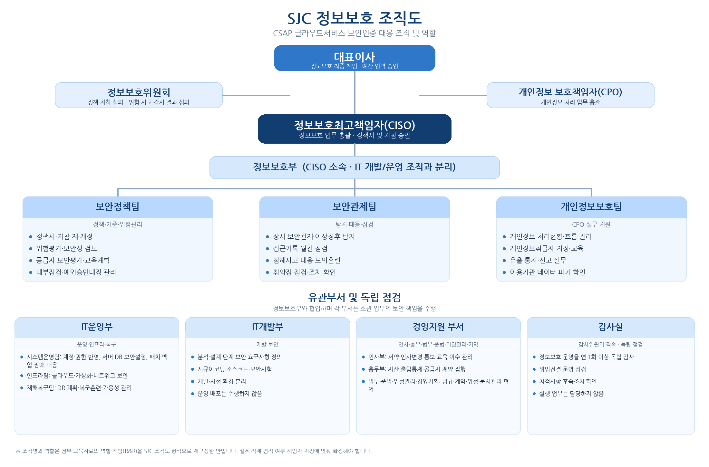

# MS8 TCP/IP

경기인력개발원 Microsoft Cyber Security 8회차 TCP/IP 학습 저장소입니다.

TCP/IP 네트워크 구조부터 Cisco Packet Tracer, 실물 네트워크 장비, 라우팅, Python 소켓 프로그래밍까지 네트워크 통신과 관련된 학습 자료 및 실습 기록을 정리합니다. 11주차부터는 CSAP(클라우드서비스 보안인증) 학습 자료와 실습 기록도 함께 정리합니다.

## 📚 학습 과정

- **학습 기간:** 2026-10-12 ~ 2026-10-30
- **교육 과정:** 경기인력개발원 Microsoft Cyber Security 8회차
- **주요 학습 분야:** TCP/IP, 네트워크 장비, 라우팅, Python 소켓 통신, CSAP 클라우드 보안인증
- **주요 학습 도구:** Cisco Packet Tracer, Python, Google Colab, 실물 L2/L3 스위치, KISA CSAP 안내서·해설서, Word·Excel·한글(HWP), Debian 12(Linux)
- **다음 학습 주제:** 클라우드 기반 취약점

## 🗂️ 학습 목차

| 순서 | 학습 자료 | 주요 내용 |
|---|---|---|
| 1 | [9주차](./9주차/) | TCP/IP 및 네트워크 관련 학습 자료 |
| 2 | [10주차](./10주차/) | 네트워크 장비 실습 및 Python 통신 관련 자료 |
| 3 | [11주차](./11주차/) | CSAP 정책서·조직·자산관리·침해사고·서비스 연속성·물리적 보안·가상화 보안·접근통제·네트워크 보안·신청서류 작성 학습 및 실습 자료 |

> 각 폴더의 세부 학습 내용은 해당 폴더에서 확인할 수 있습니다. 실제 실습 기록은 아래 날짜별 학습 내역에서도 확인할 수 있습니다.

## 🧭 권장 학습 순서

### 1. 네트워크 장비 및 통신 구조

- PC, L2 스위치, L3 스위치로 구성된 네트워크 구조 이해
- L2 스위치와 L3 스위치의 역할 구분
- 네트워크 장비 간 연결 구조 및 IP 주소 구성 확인
- 실물 네트워크 장비를 활용한 통신 테스트

### 2. SVI 및 정적 라우팅

- L2 스위치와 L3 스위치 간 SVI 구성
- L3 스위치 간 정적 라우팅(Static Routing) 구성
- 서로 다른 IP 네트워크 간 통신 테스트
- 라우팅 설정에 따른 통신 결과 확인

### 3. RIP 라우팅

- 정적 라우팅 환경에서 RIP로 학습 범위 확장
- L3 스위치 간 라우팅 설정 및 통신 테스트
- 네트워크 구성과 IP 주소 변경에 따른 통신 확인

### 4. Python 소켓 프로그래밍

- Python을 이용한 소켓 통신
- 1:1 서버·클라이언트 통신
- 1:N 서버·클라이언트 통신
- Thread를 활용한 동시 처리
- Queue를 활용한 데이터 전달 및 작업 처리

### 5. 개인 실습 환경 구성

- L3 스위치(MLS1)와 L2 스위치(SW1)를 활용한 개인 실습 환경 구성
- 네트워크 장비 설정 및 통신 테스트
- 기존 실습 내용을 직접 반복하며 네트워크 구성 능력 향상

### 6. CSAP 클라우드 보안인증

- CSAP 인증기준 구성 이해: 정보보호 정책 및 조직, 인적보안, 자산관리, 침해사고 관리, 서비스 연속성 관리, 물리적 보안, 가상화 보안, 접근통제, 네트워크 보안
- 정관 → 사규 → 정보보호규정 → 정책서 → 지침으로 이어지는 정보보호 문서 체계 이해
- 정보보호 정책서와 정보보호 조직도 작성
- 네트워크 결선도 기반 정보자산 목록 작성과 중요도(C·I·A) 평가
- 장애·침해사고 위기대응체계 적용과 로그 기반 침해사고 조사
- 백업·복구, 업무영향분석(BIA), DR 전환 판단 등 서비스 연속성 관리 실습
- 보호구역 출입통제, 서버실 설비, 기기 반출입 등 물리적 보안 현장 점검
- 클라우드 책임 공유 구조에서 가상자원, 이미지, 하이퍼바이저 보안 점검
- 계정 통합 검토, 접근기록, 인증 강화 등 접근통제와 Linux 설정 실습
- NSG, 공인 IP, Private Endpoint 등 네트워크 구성 진단과 개선 설계
- CSAP 인증 신청서 양식(HWP)을 직접 작성하며 신청 절차 이해

### 7. 보안 학습 확장

- 네트워크 기반 보안 실습
- 클라우드 기반 취약점 학습으로 범위 확장

## 📅 날짜별 학습 기록

### 2026-10-19 (44일차)

**학습 주제: 실물 네트워크 장비 테스트 및 정적 라우팅**

- 실물 장비 테스트: `PC1 - L2(SW1) - L3(MLS1) ↔ L3(MLS2) - L2(SW2) - PC3`
- L3 ↔ L2: SVI
- L3 ↔ L3: Static Routing
- IP 주소 및 장비 설정 기록
  - PC1: `192.168.10.10`
  - PC3: `192.168.30.10`
  - MLS1: `172.16.0.1`
  - MLS2: `172.16.0.2`

### 2026-10-20 (45일차)

**학습 주제: 정적 라우팅에서 RIP로 확장**

- 실물 장비 테스트: `PC1 - L2(SW1) - L3(MLS1) ↔ L3(MLS2) - L2(SW2) - PC4`
- L3 ↔ L2: SVI
- L3 ↔ L3: Static Routing → RIP
- IP 주소 및 장비 설정 기록
  - PC1: `192.168.10.10`
  - PC4: `192.168.40.10`
  - MLS1: `172.16.0.1`
  - MLS2: `172.16.0.2`

### 2026-10-22 (47일차)

**학습 주제: 실물 장비 구성 및 정적 라우팅 테스트**

- 실물 장비 테스트: `PC1 - L2(SW1) - L3(MLS1) ↔ L3(MLS2) - L2(SW2) - PC4`
- L3 ↔ L2: SVI
- L3 ↔ L3: Static Routing
- IP 주소 및 장비 설정 기록
  - PC1: `192.168.10.10`
  - PC4: `192.168.40.253`
  - MLS1: `172.16.0.10`
  - MLS2: `172.16.0.2`

### 2026-10-23 (48일차)

**학습 주제: Python 소켓 통신**

- Python Socket 통신
- 1:1 통신: 1 Server : 1 PC
- 1:N 통신: 1 Server : N PCs
- Thread를 활용한 동시 처리
- Queue를 활용한 데이터 처리

### 2026-10-25 (주말 공부)

**학습 주제: 개인 실습용 네트워크 장비 구성**

- 1인 실습용 장비 세팅
- L3 Switch: `MLS1` (Router 역할)
- L2 Switch: `SW1`
- 참고 자료: [Google Docs - 개인 네트워크 장비 실습](https://shorturl.at/XCbo9)

### 2026-10-26 (49일차)

**학습 주제: CSAP 정보보호 정책서 및 정보보호 조직도**

- CSAP 정보보호 정책서 작성 표준 틀 학습
  - 문서 체계: 정관 → 사규 → 정보보호규정 → 정책서 → 지침
  - 지침서 도출 5단계: 상위 규범 확인 → 조직·책임 확인 → CSAP 요구 매핑 → 조항 작성 → 협의·승인·공포
  - 좋은 조항의 6요소: 기준, 주기, 책임자, 방법, 예외, 기록
- 실습 1: SJC 정보보호(개인정보보호) 정책서 작성
  - 초안 → v1.0 → 최종 통합본(IS-P-01 v1.0) 순서로 보완
  - 정책서 16개 장 구성: 총칙, 정보보호 조직, 인적보안, 자산관리, 침해사고 관리, 서비스 연속성 관리 등
- SJC 정보보호 조직도 작성
  - CISO, CPO, 정보보호위원회, 정보보호부(보안정책팀·보안관제팀·개인정보보호팀) 구성
  - IT운영부, IT개발부, 경영지원 부서, 감사실의 역할과 독립 점검 구분
- 쪽지시험: CSAP 1~2장(정보보호 정책 및 조직, 인적보안) 20문항
- 참고 자료: KISA 클라우드서비스 보안인증제도 안내서(2025.02), 클라우드서비스 보안인증기준 해설서(26.07)

### 2026-10-27 (50일차)

**학습 주제: 정보보호 조직 설계, 정보자산 목록, 위기대응 체계**

- 한빛솔루션 회사 설립·조직도·정보보호 조직도 예시 학습
  - 정보보호위원회, 침해사고대응팀(CERT), 부서 정보보호책임자·담당관 구성
  - CISO, CPO 등 주요 직책자의 역할 정의와 직책 간 견제 관계
- 정보자산 목록 작성 실습 (CSAP 3장 자산관리)
  - 네트워크 결선도에서 하드웨어 자산 식별
  - 자산코드 부여: `HB-분류코드-일련번호`
  - 소유 부서·관리 부서 지정, 기밀성·무결성·가용성(C·I·A) 기준 중요도 평가
  - 자산 추가·폐기에 따른 목록 변경관리
- [별첨1] CSAP 자산관리대장(Excel): OS, WEB, WAS, DB, 스토리지, PC&VDI, 네트워크 등 분류별 시트 확인
- CSAP 위기대응 실습: 장애·침해사고 위기대응체계 적용
  - 판정 기준: 장애등급 1~4, 침해 중요도 하·중·상, 위기경보 관심-심각
  - 과제 7개: 중요도 기준 보완, 부적합 진단, 관리자 계정 탈취 대응, 이용기관 통지문, 리전 장애 DR 전환 결정, 모의훈련 계획서, 개인임무카드

### 2026-10-28 (51일차)

**학습 주제: 침해사고 관리 및 서비스 연속성 관리**

- 침해사고 관리 실습 (CSAP 5장, 인증항목 5.1.1 ~ 5.3.2, 문제 30개)
  - 5-1 사고 전 준비 점검: 중요도 판정, 비상연락망, 관제 계약
  - 5-2 로그로 사고 조사하기
  - 5-3 시간 순 상황별 사고 대응 판단
  - 5-4 보고서·통지문·재발방지 대책 작성
- 서비스 연속성 관리 실습 (CSAP 6장, 인증항목 6.1.1 ~ 6.2.3, 문제 24개)
  - 6-1 장애 기록 분석과 이용자 통지 판단
  - 6-2 성능·용량 모니터링
  - 6-3 백업·복구 사고 분석
  - 6-4 업무영향분석(BIA)과 DR 전환 판단
- 물리적 보안 실습 (CSAP 8장, 인증항목 8.1.1 ~ 8.2.6, 문제 15개)
  - 사옥 배치도와 현장 점검 메모(F01 ~ F26)를 근거로 점검
  - 8.1 보호구역 지정과 출입통제, 보호구역 내 작업과 기기 반출입
  - 8.2 서버실 설비, 폐기와 공용 환경
  - Azure 책임 범위와 위기 상황 대응 판단
- 참고 이미지: 데이터 백업 및 복구 프로세스, 정보보안 직업·자격증

### 2026-10-29 (52일차)

**학습 주제: 가상화 보안 및 접근통제**

- 가상화 보안 실습 (CSAP 9장, 인증항목 9.1.1 ~ 9.2.4, 문제 15개)
  - 환경 1: Azure(한빛 스마트워크), 하이퍼바이저는 Microsoft가 관리하고 VM·이미지·스냅샷·공개서버·API는 직접 관리
  - 환경 2: Proxmox VE(DaaS 파일럿), 하이퍼바이저까지 직접 관리
  - 책임 구분과 가상자원 관리, 공개서버·API·데이터 이전, 하이퍼바이저 보안
  - 위기 상황: 오염된 골든 이미지 대응
- 접근통제 실습 (CSAP 10장, 과제 8개)
  - PART 1 정책·기록: 접근통제 영역별 정책표, 접근기록 대상·보관·검토 절차
  - PART 2 계정·권한: 6일치 계정 통합 검토(분기 접근권한 검토서), 관리포털 권한 분류체계와 인증 설정 진단
  - PART 3 Linux 실습(Debian 12): 식별·특수권한·외부자 계정, 로그인 제한·패스워드 규칙·세션, auditd·sudo 로그·원격 보관
  - PART 4 위기 연계: 관리포털 패스워드 스프레이 대응
- 가상화 보안 실습 답안 작성본(`.docx`, `.md`) 정리

### 2026-10-30 (53일차)

**학습 주제: 네트워크 보안 및 CSAP 신청서류 작성**

- 네트워크 보안 실습 (CSAP 11장, 인증항목 11.1.1 ~ 11.1.6, 문제 15개)
  - 현황 진단: NSG 규칙, 공인 IP, 사설 대역 구성이 기준에 맞는지 점검
  - 개선 설계: Private Endpoint 적용 등 접근 경로 정리
  - 탐지와 대응: 흐름 로그 분석
  - 사고 대응: 공인 IP 서버를 통한 내부 침투
- 신청서류 작성 실습: 가상 기업 (주)새솔클라우드의 SaaS 서비스 대상
  - 실습서의 작업 1~17에 따라 신청 양식(HWP) 작성
  - 자가점검표, 인증신청 개요, 서비스 현황, 물리적 범위, 인증평가 담당자
  - 인적 범위(내부·외부 인력, 이해관계 현황), 조직도, 정보보호 조직도
  - 인증범위 내 자산, 시스템·네트워크 구성도, 주요 문서 목록
  - 작성본: HWP·DOCX 양식과 작성 결과물 정리
- ChatGPT 활용: SJC 신청서를 원본 DOCX 양식에 맞춰 작성한 초안과 미리보기(PDF)

## 🎯 학습 목표

- TCP/IP 네트워크 통신 구조
- CSAP 인증기준 이해와 정보보호 문서(정책서·조직도·자산목록) 작성
- 침해사고 대응과 서비스 연속성 관리 절차 이해
- 물리적 보안, 가상화 보안, 접근통제, 네트워크 보안 점검 기준 이해
- CSAP 인증 신청서류 작성 방법 이해

## 🌐 다음 학습 과정: 클라우드

TCP/IP 및 CSAP 학습 이후의 클라우드 실습 자료는 별도 저장소에서 관리합니다.

[CS8 Cloud 학습 저장소 바로가기](https://github.com/sinja2557/cs8-cloud)

해당 저장소에서는 다음과 같은 학습 주제를 다룹니다.

- 클라우드 기반 취약점
